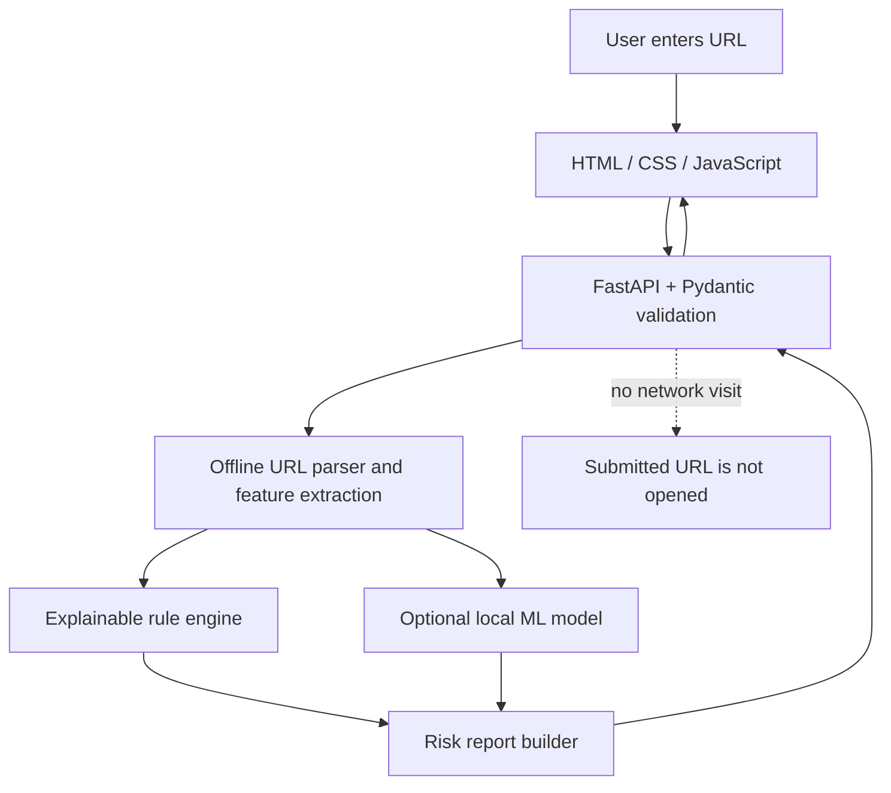

# PhishGuard — Explainable Phishing Detection System

**Tagline:** Understand the Risk. See the Evidence.

PhishGuard is an educational web application that inspects URL structure and explains configured warning indicators. It does **not** visit submitted URLs or query a live threat-intelligence service. The MVP uses transparent rules; optional machine-learning inference becomes available only after a model is trained from a documented labeled dataset.

> **Important:** A risk category is not a guarantee. “LOW OBSERVED RISK” does not mean safe, and “HIGH RISK” is not proof of maliciousness. Rule scores are application-defined points, not calibrated probabilities.

## Problem statement
Phishing links can imitate trusted services or obscure their destination. PhishGuard makes a subset of URL-structure signals visible so a user can inspect evidence rather than receive only a yes/no label.

## Features
- HTTP/HTTPS URL parsing and careful hostname normalization, including IDNA hostnames.
- Explainable rules with IDs, evidence, severity, and score contributions.
- Four risk categories: LOW OBSERVED RISK, CAUTION, HIGH RISK, INSUFFICIENT EVIDENCE.
- FastAPI JSON API and interactive `/docs`.
- Responsive single-page interface; the submitted URL is never opened.
- Optional reproducible scikit-learn training workflow, no automatic dataset downloads.
- Unit and API tests.

## Architecture


## Technology stack
Python, FastAPI, Pydantic, Uvicorn, scikit-learn, pandas, NumPy, joblib, Jinja2, HTML, CSS, JavaScript, pytest.

## Folder structure
```text
phishguard/
├── app/                  # API, schemas, URL parser, risk rules, optional ML
│   ├── static/            # CSS and browser JavaScript
│   └── templates/         # Web interface
├── data/                  # Instructions only; no dataset bundled
├── models/                # Instructions only; no model bundled by default
├── scripts/train_model.py
├── tests/                 # URL, rule engine, API tests
├── Dockerfile
├── requirements.txt
└── README.md
```

## Prerequisites
- Python 3.11+ (tested in the development container with Python 3.13.5).
- pip.
- Optional: Git and Docker.

## Run on Windows PowerShell
Open PowerShell in the extracted `phishguard` directory:

```powershell
py -3 -m venv .venv
.\.venv\Scripts\Activate.ps1
python -m pip install --upgrade pip
pip install -r requirements.txt
python -m uvicorn app.main:app --reload
```

If PowerShell blocks activation, for the current terminal only use `Set-ExecutionPolicy -Scope Process -ExecutionPolicy Bypass`, then activate again. Alternatively, run `.\.venv\Scripts\python.exe -m pip install -r requirements.txt` and `.\.venv\Scripts\python.exe -m uvicorn app.main:app --reload` without activating.

Open `http://127.0.0.1:8000` in your browser. API docs: `http://127.0.0.1:8000/docs`. Health check: `http://127.0.0.1:8000/health`.

## API example
```powershell
Invoke-RestMethod -Method Post -Uri http://127.0.0.1:8000/api/analyze -ContentType 'application/json' -Body '{"url":"https://example.com/login"}'
```

Example curl request:
```bash
curl -X POST http://127.0.0.1:8000/api/analyze -H "Content-Type: application/json" -d '{"url":"https://example.com/login"}'
```

## Tests
```powershell
python -m pytest -q
```
The test count and results should be reported from the actual run; do not assume tests passed based on this documentation.

## Optional ML dataset and training
No labeled dataset or trained model is included. Before training, obtain a dataset under terms that permit your intended use and document its source, retrieval date, license, label meanings, collection period, and limitations. CSV columns default to `url,label`, where `1` means phishing and `0` means benign.

```powershell
python scripts/train_model.py --csv data/your_labeled_dataset.csv
```

The script removes duplicate URL strings before splitting, extracts the same URL features, creates stratified train/validation/test partitions, reports accuracy/precision/recall/F1/confusion matrices, and saves a local model plus `models/evaluation.json`. Review the dataset for duplicates and source/time leakage; random splitting alone does not prove independent generalization. Generated model and evaluation artifacts are git-ignored by default.

## Risk scoring
Rules and point contributions are centralized in `app/risk_engine.py`. Thresholds: caution at 25 points, high risk at 55 points; the score is capped at 100. These thresholds are hand-defined for demonstration and have not been statistically calibrated. A low score may simply mean that the configured rules did not observe suspicious structure.

## Security and privacy
- Submitted URLs are parsed as text and are never fetched, crawled, or opened by the server.
- No database or scan history is used; submitted URLs are not intentionally persisted.
- No external threat-intelligence query is performed.
- The UI uses text-safe DOM APIs for analysis output.
- Do not paste private links containing tokens or credentials into demonstrations.

## Limitations
- URL-only heuristics can produce false positives and false negatives.
- No live reputation, DNS, certificate, page-content, or threat-feed check.
- No trained ML model until a valid dataset is supplied and training is run.
- Registrable-domain output is an approximation because the Public Suffix List is not bundled.
- The small URL-shortener and TLD lists are illustrative, not exhaustive or definitive.
- This MVP has not undergone a formal security audit or production load testing.

## Screenshots
Add screenshots after running the application locally. Do not represent mockups as verified application screenshots.

## Future improvements
- Add a maintained Public Suffix List library.
- Evaluate on time-separated and source-separated data.
- Add explicit opt-in threat-intelligence integration with privacy disclosures.
- Add accessibility review, structured logging, rate limiting, and deployment monitoring.
- Calibrate model probabilities and evaluate operational thresholds.

## Credits and dataset attribution
No third-party dataset is bundled. If you train the optional model, add the dataset citation, license/terms, and attribution here before sharing the model or repository.

## License
MIT for this project code; third-party datasets and artifacts retain their own terms. See `LICENSE`.

## Project status
The repository is intended as a runnable academic MVP. Verify tests and local startup in your own environment before submission. A public deployment is not included by default.

## Verification record (development container)

Verified on 2026-10-26 using Python 3.13.5:
- `python -m pytest -q` — **36 passed**.
- `python -m compileall -q app scripts tests` — completed without syntax errors.
- `python scripts/train_model.py --help` — command-line help starts successfully.
- Local Uvicorn smoke test — `/health` returned HTTP 200 with ML status `not_trained`; `/` returned HTTP 200; a demonstration IP-host URL returned `HIGH RISK` with a score of 60.

These are development-container checks, not a claim that the project has been run on the student's laptop, publicly deployed, security-audited, or evaluated on a real labeled dataset. The ML model is intentionally untrained because no labeled dataset was supplied.